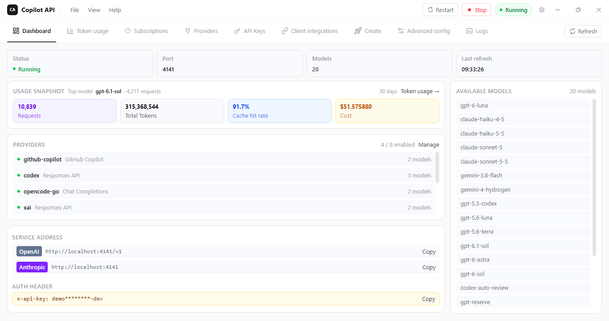
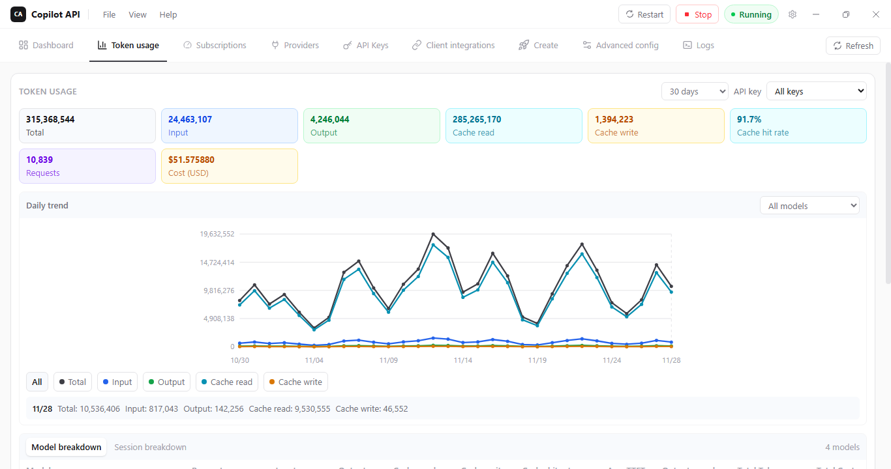

# Copilot API

<p align="center">
  
</p>

<p align="center">
  <strong>Universal AI Gateway</strong><br />
  One Gateway. Any Client. Multiple AI Providers.<br />
  Chat Completions &middot; OpenAI Responses &middot; Anthropic Messages
</p>

<p align="center">
  <a href="https://www.npmjs.com/package/@jeffreycao/copilot-api"></a>
  <a href="https://github.com/caozhiyuan/copilot-api/blob/dev/LICENSE"></a>
  <a href="https://github.com/caozhiyuan/copilot-api/stargazers"></a>
  <a href="https://bun.sh">= 1.4.4"></a>
  <a href="https://nodejs.org"></a>
</p>

<p align="center">
  <a href="README.md">English</a> | 简体中文
</p>

Copilot API 是一个本地 AI 网关。你可以把 Claude Code、OpenCode、Codex 等客户端连接到它，再通过同一个地址使用 GitHub Copilot、Codex、xAI 或其他模型服务。

<a id="highlights"></a>

## 功能亮点

- **一个地址，三种接口**：提供 OpenAI 兼容的 Chat Completions（`/v1/chat/completions`）、OpenAI Responses（`/v1/responses`）和 Anthropic 兼容的 Messages（`/v1/messages`），方便不同客户端接入。
- **支持多家模型服务**：可使用 GitHub Copilot、内置 Codex 和 xAI，也可接入 Kimi、DeepSeek、阿里云百炼（DashScope）、OpenRouter、OpenCode Go、Google Gemini 等服务。先登录账号或填写 API Key，再启动网关。不使用 GitHub Copilot 也可以运行，只需配置并启用至少一个模型服务（provider）。
- **方便接入编程助手**：提供 Claude Code、OpenCode 和 Codex 的配置指南，支持在客户端自动显示网关提供的模型。
- **支持流式输出**：三种接口都支持 SSE，可以边生成边返回内容。网关连接 Copilot 时会根据模型能力使用 WebSocket 或 HTTP；连接 Codex 时，流式请求默认使用 WebSocket，也可通过 `useResponsesApiWebSocket` 切换为 HTTP。
- **提供桌面应用**：可在界面中登录 GitHub Copilot、Codex 和 xAI，配置模型服务，查看 Token 用量和日志，并一键启动或停止网关。

<a id="quick-start"></a>

## 快速开始

请使用已安装下述安全更新的 **Node.js 22.x、24.x 或 26.x**（npx），或 **Bun >= 1.4.4**。使用 GitHub Copilot 时需要相应订阅；也可以配置其他 provider 独立运行。

> [!WARNING]
> **CVE-2026-111497 安全提示：** 受影响的 Node.js 和 Bun 内置 Brotli 解码器存在内存破坏及远程代码执行风险。请将 Node.js 22.x 升级至 **22.23.4 或更高版本**、24.x 升级至 **24.22.1 或更高版本**，或 26.x 升级至 **26.12.1 或更高版本**；Bun 请升级至 **1.4.4 或更高版本**。升级后重启网关；Docker 部署请使用修复后的运行时重新构建并部署镜像。详见 [Node.js 安全公告](https://nodejs.org/en/blog/vulnerability/october-2026-security-releases)和 [Bun 安全公告](https://github.com/oven-sh/bun/security/advisories/GHSA-663w-cv8g-jj2p)。

```sh
npx @jeffreycao/copilot-api@latest start
```

服务默认监听 `http://localhost:4141`。也可以先登录 GitHub Copilot 或配置第三方 provider：

```sh
npx @jeffreycao/copilot-api@latest auth login
```

也可以使用 Bun >= 1.4.4 运行，可获得更好的性能：

```sh
bunx --bun @jeffreycao/copilot-api start
```

`--bun` 用于选择 Bun 运行时，日常启动省略 `@latest` 以复用缓存。全局安装与升级方式见 [Bun 使用说明](docs/guides/zh-CN/getting-started.md#using-with-bun)。

> [!NOTE]
> 如需信任系统安装的 CA 证书（例如使用企业 HTTPS 代理时），`npx` 无需额外设置：Node.js >= 22.19.0 启动时会通过 [`tls.setDefaultCACertificates()`](https://nodejs.org/api/tls.html#tlssetdefaultcacertificatescerts) 自动合并系统 CA 证书。只有 Bun 需要在运行 `bunx --bun` 前设置 `NODE_USE_SYSTEM_CA=1`：bash/zsh 使用 `export NODE_USE_SYSTEM_CA=1`，PowerShell 使用 `$env:NODE_USE_SYSTEM_CA="1"`（Bun >= 1.4.4）。
> 桌面应用默认会为启动的服务设置这个变量；如果你已经设置过，则使用你的设置。

验证网关已启动：

```sh
curl http://localhost:4141/v1/models
```

> [!NOTE]
> 保存 Token 用量历史需要 Bun >= 1.4.4，或带内置 `node:sqlite` 的 Node.js（22.13.0 起可用）。请使用上方安全公告中的已修补 Node.js 版本。详见[通过 npx 使用](docs/guides/zh-CN/getting-started.md#using-with-npx)。

接下来可按你的客户端选择指南：[与 Claude Code 一起使用](docs/guides/zh-CN/claude-code.md#using-with-claude-code)、[与 OpenCode 一起使用](docs/guides/zh-CN/opencode.md#using-with-opencode)、[与 Codex 一起使用](docs/guides/zh-CN/codex.md#using-with-codex)、[与 DeepSeek Harness 一起使用](docs/guides/zh-CN/dsh.md#using-with-deepseek-harness)，或通过 [Docker](docs/guides/zh-CN/docker.md#using-with-docker) 运行。

**Codex 多 Agent 兼容性：** 可通过 [`codexMultiAgentV1`](docs/guides/zh-CN/configuration.md#codex-多-agent-兼容性) 在目录中声明 V1，默认仍为 V2。应用网关配置后需**新建 Codex 会话**。运行中刷新目录不会切换会话已确定的版本，恢复旧会话也会沿用已记录的版本；CLI 显式配置可能优先。

<a id="compatibility"></a>

## 兼容性

客户端统一连接网关的本地地址。网关根据所选模型，将请求发给 GitHub Copilot、Codex、xAI 或其他已配置的模型服务；双方协议不同时，由网关负责转换。

**客户端 / 协议矩阵**

| 客户端 | Chat Completions | Responses | Anthropic Messages | 推荐 |
|---|:---:|:---:|:---:|---|
| Claude Code | — | — | ✅ 原生 / 适配 | Anthropic Messages |
| OpenCode | ✅ 原生 | ✅ 原生 / 适配 | ✅ 原生 / 适配 | v2：Responses；v1：Messages |
| Codex | — | ✅ 原生 / 适配 | — | Responses |
| DeepSeek Harness | — | ✅ 原生 / 适配 | ✅ 原生 / 适配 | Responses |
| OpenAI 兼容客户端 | ✅ 原生 | ✅ 原生 / 适配 | — | Chat Completions |
| Anthropic 兼容客户端 | — | — | ✅ 原生 / 适配 | Anthropic Messages |

**模型服务与接口。** 能用哪些接口，取决于具体模型。Chat Completions 需要模型服务原生支持；Responses 和 Messages 在网关支持转换时，也能连接使用其他协议的模型。内置 `codex` provider 原生使用 Responses；第三方 provider 可选择 `anthropic`、`openai-compatible` 或 `openai-responses`，也可按模型覆盖。

<a id="desktop-app"></a>

## 桌面应用

更喜欢图形界面？下载安装桌面应用后，就可以登录账号或填写 API Key，再一键启动本地服务。界面会显示服务地址、认证请求头、可用模型、用量和日志。

<p align="center">
  
  
</p>

Windows x64（`.exe`）、macOS Apple Silicon（`.dmg`）和 Linux x64（`.AppImage`）安装包发布在 [GitHub Releases](https://github.com/caozhiyuan/copilot-api/releases)。完整配置与高级设置见 [Electron 桌面应用](docs/guides/zh-CN/desktop.md#electron-desktop-app)。

首次下载完整安装包安装后，后续更新通常会使用增量下载，减少下载量。macOS 首次更新若尚无 DMG 缓存，可能会先完整下载一次以建立缓存；缓存不可用或增量下载失败时，会自动回退完整下载。

## 文档导航

| 文档 | 内容 |
| --- | --- |
| [安装与启动](docs/guides/zh-CN/getting-started.md) | 环境要求、项目概览、npx 与源码运行、不登录 Copilot 使用其他模型服务，以及网关 API Key 配置 |
| [Claude Code](docs/guides/zh-CN/claude-code.md) | settings.json、网关模型发现、模型映射、自动压缩窗口与 WebSearch 行为 |
| [OpenCode](docs/guides/zh-CN/opencode.md) | v2 Responses 插件与自动模型发现、原生压缩、模型能力与价格、上下文上限，以及 v1 Anthropic SDK 配置 |
| [Codex](docs/guides/zh-CN/codex.md) | 完整的 `config.toml` provider 配置块、`GITHUB_COPILOT_API_KEY` 环境变量设置、自动审核模型映射、生成 `model_catalog.json`，以及合并后的模型选择器目录与协议适配 |
| [AGY CLI](docs/guides/zh-CN/agy-cli.md) | Gemini 网关接入、跨平台配置与 [AGY CLI Statusline](docs/guides/zh-CN/agy-cli.md#agy-cli-statusline) |
| [DeepSeek Harness](docs/guides/zh-CN/dsh.md) | 安装 `dsh-copilot-api`、保存网关 API 密钥，并选择 Responses 或 Messages |
| [Docker](docs/guides/zh-CN/docker.md) | Docker Compose 快速启动、`/data` 持久化挂载与属主修复、支持的环境变量，以及监听所有网卡地址 |
| [桌面应用](docs/guides/zh-CN/desktop.md) | Copilot 登录、Codex OAuth 账号切换、API Key provider、一键启停、共享模型映射、高级设置与各平台安装包 |
| [插件与工具搜索](docs/guides/zh-CN/integrations.md) | Responses `tool_search` MCP 桥接（opencode v2 已通过 Code Mode 延迟加载工具，不需要）、Claude Code 的 `agent-inject` 与 `tool-search` 市场插件，以及 OpenCode 会话追踪插件 |
| [网关事件插件](docs/guides/zh-CN/gateway-plugins.md) | 编写服务端监控插件，获取请求状态、耗时和用量 |
| [用量监控](docs/guides/zh-CN/usage.md) | 用量面板地址与查询参数、时间范围选择、Copilot 配额进度、Token 与成本指标卡、趋势图，以及分页的请求事件列表 |
| [命令行参考](docs/guides/zh-CN/cli.md) | 命令结构、全局选项，以及 `start`、`auth`、`debug` 子命令的完整参数与使用示例 |
| [配置参考](docs/guides/zh-CN/configuration.md) | `config.json` 全部配置项：网关与管理 API Key、provider 定义、模型映射、WebSocket 与 HTTP 传输、超时与上下文管理 |
| [API 与认证](docs/guides/zh-CN/api.md) | 支持的认证请求头与 CORS 规则、OpenAI / Codex 后端 / Anthropic 端点、用量监控接口与管理配置接口 |
| [故障排查](docs/guides/zh-CN/troubleshooting.md) | Copilot 模型列表中缺少 Claude 模型的处理方法 |

使用 GitHub Copilot 前请阅读 [GitHub Copilot 安全提示](NOTICE.md#github-copilot-security-notice)。
