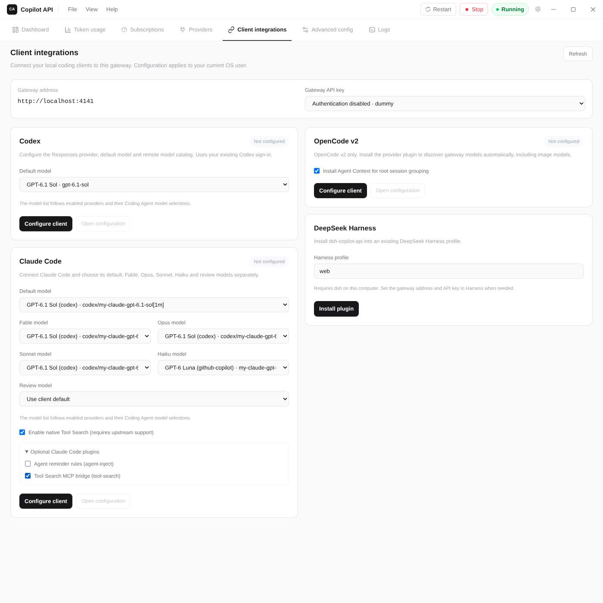

# Desktop App

[Home](../../../README.md) · [Documentation](README.md) · [简体中文](../zh-CN/desktop.md)

## Electron Desktop App

The desktop app manages account sign-in, provider configuration, and the local gateway. Clients connect to the local address displayed in the app.

### Download and install

Download your installer from [GitHub Releases](https://github.com/caozhiyuan/copilot-api/releases): Windows x64 (`.exe`), macOS Apple Silicon (`.dmg`), or Linux x64 (`.AppImage`).

The macOS build currently has no Apple Developer ID signature or notarization. If macOS reports that `Copilot API.app` "is damaged and can't be opened", first download the DMG from the official Release and move the app into `/Applications`. After verifying the download source, remove the quarantine attribute for this app in Terminal:

```sh
sudo xattr -dr com.apple.quarantine "/Applications/Copilot API.app"
```

Then try opening the app again. This command only affects the specified app; it does not disable Gatekeeper globally. If the app still fails to launch, re-download the installer and check whether the file is actually damaged.

On Linux, make the downloaded AppImage executable before launching it:

```sh
chmod +x Copilot-API-*-linux-x86_64.AppImage
./Copilot-API-*-linux-x86_64.AppImage
```

### Sign in and start

1. Sign in to GitHub Copilot, Codex, or xAI, or enter an API key for Kimi, DeepSeek, DashScope, OpenRouter, or a custom provider.
2. Choose a port and start the service. Bun >= 1.4.4 is recommended; the bundled Node.js runtime works without a separate installation.
3. Point your client at the local address displayed in the app and supply its gateway API key.
4. Use the Dashboard to check models, authentication headers, and service status; open logs to inspect requests.

Codex supports manual switching among up to 3 accounts and removal of inactive accounts. Retrying GitHub sign-in supersedes the previous attempt; an older attempt cannot overwrite a newer completed sign-in.

The Dashboard summarizes requests, total tokens, cache hit rate, estimated cost, and the busiest model for the selected period. Token history uses SQLite from the selected runtime.

### Connect coding clients

Open **Client integrations** after configuring your providers. The page uses the gateway's current address and a selected gateway API key (or `dummy` when authentication is disabled). Start the service to load client-specific model lists; existing configurations and plugins can also be updated while it is stopped.



| Client | Setup |
| --- | --- |
| Claude Code | Select a default model and an optional Haiku model. The main model also supplies the Opus, Sonnet and Fable aliases. Merge gateway settings into user `settings.json`; optionally install the `agent-inject` or `tool-search` plugin from the GitHub-hosted `copilot-api` marketplace through the Claude CLI. Native Tool Search and the MCP bridge are separate choices. |
| OpenCode v2 | Install the bundled model-discovery provider and optionally Agent Context into the global plugin directory. Connection settings follow the selected address and key. OpenCode v1 is not supported by this page. |
| Codex | Select a model and its reasoning effort, sandbox mode, approval reviewer, web search mode, and Features switches in separate groups. Changing the model selects its highest supported reasoning effort. Configure the `copilot_api` Responses provider and remote model catalog; save the gateway key as the user environment variable `GITHUB_COPILOT_API_KEY`, preserving existing Codex sign-in. |
| DeepSeek Harness | Select a profile, save `COPILOT_API_BASE_URL` and `GITHUB_COPILOT_API_KEY` to `$DSH_HOME/.env` (default `~/.dsh/.env`), and install `dsh-copilot-api`. Other variables and comments are preserved; Restore backup restores this file. Restart Harness after setup. |

Install the clients themselves separately. Claude plugin installation requires a working `claude` command and access to the GitHub marketplace; Harness plugin installation requires `dsh` and its package-manager dependencies. Configuration targets the current OS user, including `CLAUDE_CONFIG_DIR`, `CODEX_HOME` and `XDG_CONFIG_HOME` when set; Windows and WSL are separate environments.

Configuration edits preserve unrelated settings and comments. **Restore backup** restores the state before the first setup, including files created by the integration and the previous Codex environment value. Newly installed Claude plugins are uninstalled with their data preserved; pre-existing plugins are kept. Plugin removal failures are reported separately and do not prevent configuration restoration. Restore refuses to overwrite subsequent external file or environment edits. Symbolic-link configurations require manual editing.

Restart clients after setup. For Codex, fully quit and reopen both the app and terminals. macOS saves a user LaunchAgent to restore the key at login; Linux updates Bash/Zsh startup files and requires signing in again for desktop apps. **Refresh** reloads configuration status and available models after gateway changes.

### View subscriptions

Open **Subscriptions** to view plan names, remaining allowances, reset times, and balances. Refresh providers individually or use **Refresh all**.

- **GitHub Copilot**: Premium, Chat, and Completions allowances.
- **Codex**: Personal/model windows and Business workspace credits/member limits.
- **xAI**: Grok Build weekly/monthly allowances, legacy monthly budgets, pay-as-you-go usage, and prepaid balances.
- **OpenCode Go**: Rolling 5-hour, weekly, and monthly usage percentages and reset times, using the configured API key.

Cards use bundled models.dev logos. Data loads from the local service on the first visit and remains available until you refresh, including after switching tabs. The web viewer offers the same Subscriptions tab; Token Usage shows request history and performance.

### Image and video creation

Start the service and open **Create** to generate images, edit uploaded images, or generate videos.

Images have editable model, size, quality, and output count (1–4). Edits accept up to 5 PNG, JPEG, or WebP files, at most 20 MiB each and 40 MiB total.

The model field defaults to `gpt-image-2` without loading the model catalog. At request time, the gateway selects an available provider's default image model in Codex → GitHub Copilot → xAI order. Clearing the field also enables automatic selection. Enter a `provider/model` alias or configure a model mapping to select a specific target.

Video creation uses `xai/grok-imagine-video-1.5` and requires an enabled xAI provider. Use a prompt, one first-frame image, or both; choose 1–15 seconds, 480p/720p/1080p, and audio. The page checks progress every 5 seconds and offers pause, resume, and stop tracking. Switching tabs preserves drafts, results, and tasks; closing or reloading the app clears this temporary state. **Stop waiting** and **Stop tracking** only stop local waiting or polling; they do not cancel an upstream generation task.

Preview results in the page and save them through the system file dialog. Video URLs are temporary, so save finished videos promptly.

### Change settings

Settings include the server runtime, listening host, proxy, logging, minimize-to-tray, `OAuth App`, `API Home`, `SQLite DB Path`, and `Enterprise URL`. Changes take effect as follows:

| Settings | When changes take effect |
| --- | --- |
| Providers, gateway API keys, accounts | The running service refreshes automatically; new requests use the new configuration. |
| Server runtime, listening host, proxy, verbose logging, token logging | Saving restarts the running service and may interrupt active requests. |
| OAuth App, API Home, SQLite DB Path, Enterprise URL | Restart the desktop app. |

Saving while the service is stopped does not start it.

#### Choose Bun or Node.js

New installations default to **Bun (recommended)**. Existing configurations without a runtime selection keep bundled Node.js on upgrade to preserve system proxy and PAC behavior. Change the runtime under **Settings → Startup → Server runtime**.

Only stable Bun >= 1.4.4 is used. Missing, older, or unusable installations fall back to bundled Node.js. Settings show detection status; server logs show the actual runtime. Choose **Node.js (bundled)** to use it without a separate Node.js installation.

#### Use a proxy

Bun receives HTTP/HTTPS proxy and bypass settings from **Network → Custom proxy**. It does not read Electron's system proxy or PAC settings; select bundled Node.js if you need those. The desktop UI and updates still use the app's selected proxy mode. Saving a server runtime change restarts the running service.

#### Edit gateway configuration

Use **Advanced config** to edit `config.json`, including model mappings, through grouped fields or full JSON. Editing works while the service is stopped. A running service reloads through `/admin/config/reload` using `auth.adminApiKey`. See the [configuration editor](configuration.md#desktop-configuration-editor) for validation, masking, file conflicts, and apply retries.

### Update the app

Packaged builds check the latest stable GitHub Release 15 seconds after launch and every 6 hours. You can also use **Settings → Updates → Check for updates**. Windows NSIS and Linux AppImage builds download updates automatically and verify the installer against the SHA-512 checksum in the release metadata. Click **Restart and install** when ready; installation stops the local API server and interrupts active requests. Closing the app does not install a pending update.

macOS downloads a complete, SHA-512-verified DMG to your system Downloads folder. After the first full download, later updates can reuse the cached DMG and download only changed blocks. Missing or damaged caches and failed differential requests fall back to a full download. A cached installer can be reused even if you have not installed that version yet.

When the installed macOS application and its parent directory support replacement, **Restart and install** prepares the new application, stops the server, and uses a separate helper to replace and restart it. The helper keeps the previous app until the new app acknowledges startup and attempts to restore it if startup fails. User configuration and databases are not replaced. **Show in folder** and **Open installer** remain available for manual installation. Apps running from a DMG, App Translocation, or a non-writable location use manual installation. A failed automatic preparation also retains the downloaded DMG for manual use.

These builds do not have Developer ID signing or notarization. The custom macOS installer does not use Squirrel.Mac and does not disable system security checks; macOS may still require you to allow a new version to open. Linux builds launched outside an AppImage and older releases without updater metadata use the release-page download link. Development builds do not check for updates. Update requests use the app's configured proxy.

### Bun detection and update metadata

When the service runtime is set to Bun, set `COPILOT_API_BUN_DIR` to the absolute directory containing the native binary, `bun.exe` on Windows or `bun` on macOS and Linux. Restart the desktop app after setting the variable.

If the configured directory is unset or its Bun is unavailable, the app checks `PATH`, `BUN_INSTALL`, the user Bun installation directory, and common desktop installation locations.

Bun installed with `npm install -g bun` under nvm is also supported on Windows, macOS, and Linux. Detection checks the active `NVM_BIN` or `NVM_SYMLINK`, the configured npm global prefix, and installed Node versions under `NVM_DIR`/`NVM_HOME` or common default nvm directories (including XDG locations). Without an active version in the desktop environment, Node version directories are searched newest first for a supported Bun. On Windows, the app runs the npm package's native `bun.exe` directly.

Bun runs the JavaScript shipped with the app directly (`bun --no-orphans --no-install <resources>/server/main.js start ...`); it does not run `bunx`, install an npm package, or launch the TypeScript source. The desktop bundle includes its dependencies, and the app manages the child's logs, readiness, restart, and termination. Install or upgrade Bun separately, then start or restart the server to detect it again.

The desktop release workflow uploads `latest.yml`, Windows `.blockmap` files, `latest-linux.yml`, macOS `.dmg.blockmap` files, and `latest-mac.yml` alongside installers. Installers are uploaded before update metadata. Releases without these files require manual installation first; the first macOS download may also be full because no DMG baseline exists yet.
