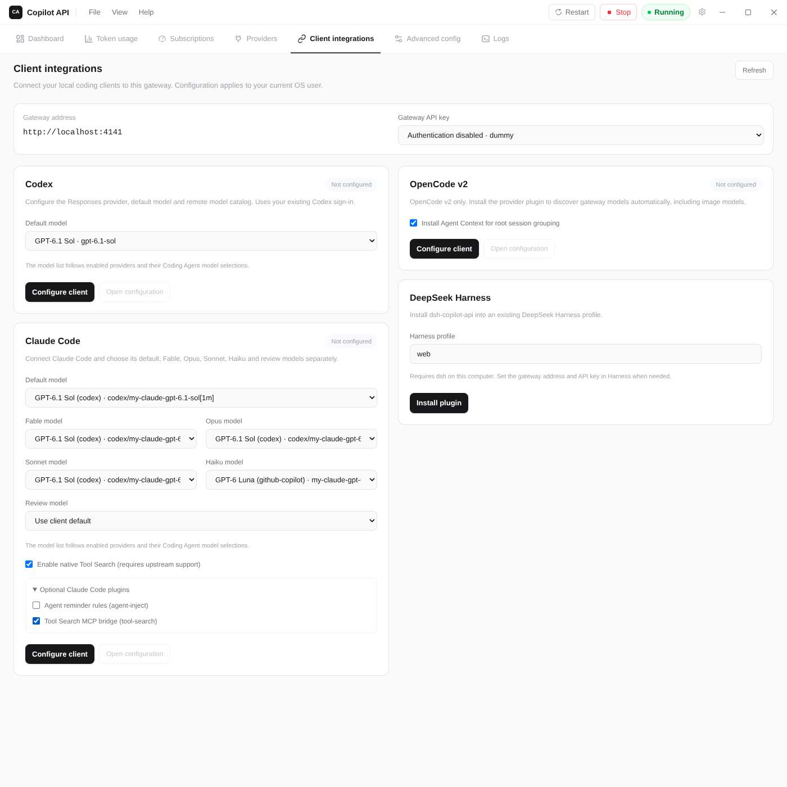

# 桌面应用

[项目首页](../../../README.zh-CN.md) · [文档目录](README.md) · [English](../en/desktop.md)

<a id="electron-desktop-app"></a>

## Electron 桌面应用

桌面应用可以帮你登录账号、配置模型服务，并一键启动本地网关。客户端仍通过应用中显示的本地地址连接。

### 下载与安装

从 [GitHub Releases](https://github.com/caozhiyuan/copilot-api/releases) 下载对应安装包：Windows x64（`.exe`）、macOS Apple Silicon（`.dmg`）或 Linux x64（`.AppImage`）。

macOS 安装包目前未经过 Apple Developer ID 签名和公证。如果从官方 Release 下载 DMG，将 `Copilot API.app` 拖到「应用程序」（`/Applications`）后，打开时提示“已损坏，无法打开”，可在确认下载来源可信后，在终端移除该应用的下载隔离属性：

```sh
sudo xattr -dr com.apple.quarantine "/Applications/Copilot API.app"
```

之后重新打开应用。此命令只针对指定的 App，不会全局禁用 macOS Gatekeeper；如果仍然无法启动，请重新下载并检查安装包是否确实损坏。

Linux 用户需要先为下载的 AppImage 添加执行权限：

```sh
chmod +x Copilot-API-*-linux-x86_64.AppImage
./Copilot-API-*-linux-x86_64.AppImage
```

### 登录账号并启动

1. 在应用中登录 GitHub Copilot、Codex 或 xAI，或填写 Kimi、DeepSeek、DashScope、OpenRouter 等服务的 API Key。也可添加自定义 provider。
2. 选择端口并启动服务。推荐安装 Bun >= 1.4.4；未安装时可使用应用内置的 Node.js。
3. 将 Claude Code、OpenCode 或 Codex 等客户端的服务地址改为应用中显示的本地地址，并填写对应的网关 API Key。
4. 在 Dashboard 查看可用模型、认证请求头和服务状态，在日志页检查请求情况。

Codex 最多保存 3 个账号，可手动切换，也可移除未在使用的账号。重新发起 GitHub 登录会取代之前的尝试，旧尝试不会覆盖新的登录结果。

Dashboard 顶部会汇总所选时间范围的请求数、总 Token、缓存命中率、预估费用和请求最多的模型。Token 用量历史使用当前服务运行时提供的 SQLite 保存。

### 接入 Coding 客户端

配置好 Provider 后，打开 **客户端接入**。页面自动使用网关当前地址，并选择一个网关 API Key；未启用鉴权时使用 `dummy`。启动服务后可读取各客户端的模型列表，服务停止时仍可更新已有配置和安装插件。



| 客户端 | 一键操作 |
| --- | --- |
| Claude Code | 选择默认主模型和可选的 Haiku 小模型，主模型也用于 Opus、Sonnet、Fable 别名；合并写入用户 `settings.json`，可通过 Claude CLI 从 GitHub 上的 `copilot-api` marketplace 安装 `agent-inject`、`tool-search` 插件。原生 Tool Search 和 MCP bridge 分开选择。 |
| OpenCode v2 | 将模型发现 Provider 和可选的 Agent Context 安装到全局插件目录，连接设置使用当前地址和密钥。此页面仅支持 v2。 |
| Codex | 选择默认模型，配置 `copilot_api` Responses Provider 和远程模型目录；将网关密钥保存为用户环境变量 `GITHUB_COPILOT_API_KEY`，保留已有 Codex 登录。 |
| DeepSeek Harness | 选择 profile，将 `COPILOT_API_BASE_URL` 和 `GITHUB_COPILOT_API_KEY` 保存到 `$DSH_HOME/.env`（默认 `~/.dsh/.env`），并安装 `dsh-copilot-api`。保留其他变量和注释，支持恢复原始文件；配置后请重启 Harness。 |

客户端本体需单独安装。Claude 插件安装需要可用的 `claude` 命令并能访问 GitHub marketplace；Harness 插件安装需要 `dsh` 及其包管理器依赖。配置对当前操作系统用户生效，并识别已设置的 `CLAUDE_CONFIG_DIR`、`CODEX_HOME`、`XDG_CONFIG_HOME`；Windows 和 WSL 分别配置。

配置合并保留无关字段和注释。**恢复备份** 会恢复首次配置前的状态，包括接入时新建的文件和原有 Codex 环境变量值；仅移除本功能新安装的 Claude 插件并保留插件数据，保留预先安装的插件。恢复操作不会覆盖安装后的外部文件或环境变量修改。符号链接配置需手动编辑。

配置后请重启客户端。Codex 需完全退出并重新打开应用和终端；macOS 通过用户 LaunchAgent 在登录后恢复密钥，Linux 更新 Bash/Zsh 启动文件，桌面应用需重新登录系统。修改网关配置后，点击 **刷新** 重新读取配置状态和模型。

### 查看订阅额度

打开**订阅额度**标签页，可以查看套餐、剩余额度、重置时间和余额。支持单独刷新，也可点击**全部刷新**。

- **GitHub Copilot**：Premium、Chat 和 Completions 额度。
- **Codex**：个人与模型额度窗口，以及 Business 工作区 Credits 和成员上限。
- **xAI**：Grok Build 每周和每月额度、旧版月度额度、按量付费用量和预付余额。
- **OpenCode Go**：使用已配置的 API Key，显示滚动 5 小时、每周和每月的用量百分比与重置时间。

卡片使用应用内置的 models.dev 品牌标识。首次打开时从本地服务加载数据，切换到其他标签页再返回时保留结果，直到手动刷新。网页看板也有相同功能；Token 用量页用于查看请求历史和性能统计。

### 图片与视频创作

启动服务后，打开**创作**标签页，可以生成图片、修改上传的图片，或生成视频。

图片可设置模型、尺寸、质量和数量（1–4 张）。修改图片时最多上传 5 张 PNG、JPEG 或 WebP，每张不超过 20 MiB，总计不超过 40 MiB。

图片模型默认填写 `gpt-image-2`，不需要先加载模型列表。发送请求时，网关按 Codex → GitHub Copilot → xAI 的顺序选择可用服务的默认图片模型；清空模型框也会自动选择。要固定使用某个服务，可填写 `provider/model`，或配置模型映射。

视频使用 `xai/grok-imagine-video-1.5`，需启用 xAI 服务。可填写提示词、添加一张首帧图片，或同时使用两者；时长 1–15 秒，分辨率 480p、720p 或 1080p，以及音频开关。提交后每 5 秒查询一次任务状态；可暂停、继续查询或结束跟踪。切换标签页会保留草稿、结果和任务，关闭或刷新应用会清除这些临时内容。**停止等待**和**结束跟踪**仅停止本地等待或查询，不会撤销已提交到上游的生成任务。

生成结果可在页面预览，并通过系统保存对话框保存到本地。视频链接有有效期，请及时保存。

### 修改设置

设置页提供服务运行时、监听地址、代理、日志、最小化到托盘，以及 `OAuth App`、`API Home`、`SQLite DB Path` 和 `Enterprise URL` 等选项。不同设置的生效方式如下：

| 修改内容 | 生效方式 |
| --- | --- |
| Provider、网关 API Key、账号 | 自动刷新运行中的服务，新请求使用新配置。 |
| 服务运行时、监听地址、代理、详细日志、Token 日志 | 保存后自动重启运行中的服务，进行中的请求可能中断。 |
| OAuth App、API Home、SQLite DB Path、Enterprise URL | 重启桌面应用后生效。 |

服务未运行时只保存设置，不会自动启动。

#### 选择 Bun 或 Node.js

新安装默认使用 **Bun（推荐）**。旧配置如果没有选择过运行时，升级后继续使用内置 Node.js，保留原来的系统代理和 PAC 行为。可在**设置 → 启动参数 → 服务运行时**中切换。

Bun 需要稳定版 1.4.4 或更高版本。未安装、版本过低或无法运行时，应用会自动改用内置 Node.js。设置页显示检测结果，服务日志显示实际使用的运行时。选择 **Node.js（内置）** 后，无需另外安装 Node.js。

#### 使用代理

Bun 使用**网络 → 自定义代理**中配置的 HTTP/HTTPS 代理和绕过规则，不读取 Electron 的系统代理或 PAC。如果需要系统代理或 PAC，请选择内置 Node.js。桌面界面和更新下载仍使用应用中选择的代理模式。修改服务运行时并保存后，会自动重启运行中的服务。

#### 编辑网关配置

在**高级配置**中，可通过分组表单或完整 JSON 编辑 `config.json`，包括模型映射。服务停止时也能编辑。保存并应用后，运行中的服务通过 `/admin/config/reload` 刷新，使用 `auth.adminApiKey` 认证。校验、密钥隐藏、文件冲突和重试方式见[配置编辑器说明](configuration.md#桌面端配置编辑器)。

### 更新应用

打包后的应用会在启动 15 秒后，以及每 6 小时检查 GitHub 最新稳定版。也可以通过 **设置 → 应用更新 → 检查更新** 手动触发。Windows NSIS 和 Linux AppImage 会自动下载更新，并使用 release 元数据中的 SHA-512 校验安装包。下载完成后点击 **重启并安装**；安装前会停止本地 API 服务，中断进行中的请求。正常关闭应用不会安装待更新版本。

macOS 会将经过 SHA-512 校验的完整 DMG 保存到系统下载目录。首次完整下载建立缓存后，后续更新可复用旧 DMG，只下载变化的数据块；缓存缺失、损坏或差分请求失败时改为下载完整安装包。即使下载后尚未安装该版本，也可以使用其缓存准备后续更新。

安装位置和父目录允许替换时，点击 **重启并安装** 会先准备新版应用，再停止服务，由独立辅助进程替换并重启。辅助进程会保留旧版，直到新版确认启动；启动失败时尝试恢复旧版。用户配置和数据库不会被替换。同时保留 **在文件夹中显示** 和 **打开安装包**，方便手动安装。直接从 DMG、App Translocation 或不可写位置运行时使用手动安装；自动安装准备失败后，也会保留已下载的 DMG。

当前构建没有 Developer ID 签名和 Apple 公证。自定义安装流程不调用 Squirrel.Mac，也不关闭系统安全检查；macOS 仍可能要求用户允许打开新版本。在 AppImage 之外启动的 Linux 应用，以及缺少更新元数据的旧 release，会提供 release 页面下载入口。开发模式不检查更新。更新请求使用应用中配置的代理。

### Bun 检测与更新文件的技术说明

应用会检查 `PATH`、`BUN_INSTALL`、用户 Bun 安装目录和常见桌面安装位置。请自行安装或升级 Bun，之后启动或重启服务即可重新检测。

Windows、macOS 和 Linux 均支持通过 nvm 下的 `npm install -g bun` 安装 Bun。检测会检查当前 `NVM_BIN` 或 `NVM_SYMLINK`、显式配置的 npm 全局安装前缀，以及 `NVM_DIR`/`NVM_HOME` 或常见默认 nvm 目录（含 XDG 路径）下的各 Node 版本。桌面环境没有当前版本信息时，按 Node 版本从新到旧查找可用的 Bun；Windows 会直接运行 npm 包内的原生 `bun.exe`。

Bun 直接运行桌面应用随包发布的 JavaScript（`bun --no-orphans --no-install <resources>/server/main.js start ...`），不会调用 `bunx`、安装 npm 包或执行 TypeScript 源码。桌面服务 bundle 已包含依赖，应用继续管理子进程日志、就绪检测、重启及退出。请自行安装或升级 Bun，之后启动或重启服务即可重新检测。

桌面发布流程会一并上传 `latest.yml`、Windows `.blockmap`、`latest-linux.yml`、macOS `.dmg.blockmap` 和 `latest-mac.yml`，先上传安装包，再上传更新元数据。缺少这些文件的旧版本需要先手动安装一次新版本；macOS 尚无 DMG 缓存时，第一次下载也可能是完整包。
